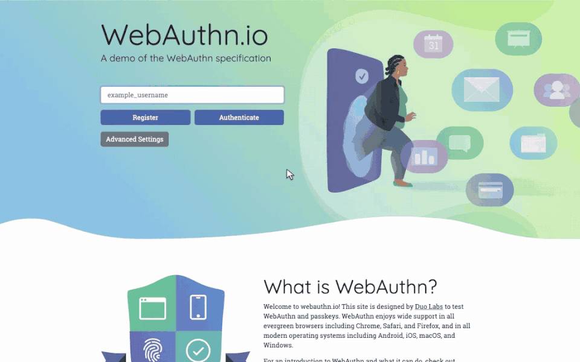

# WebAuthn Interceptor

A Chrome extension for inspecting and editing WebAuthn requests and responses.
Requests can still go through your existing authenticators, including 1Password,
Bitwarden, iCloud Keychain, and security keys. You can also use
[badAuthenticator](https://github.com/tantosec/badAuthenticator) or supply a response yourself.



## Install

> [!WARNING]
> This extension has broad access to the websites you visit. Only install it if you
> trust the code. A malicious extension with these permissions could act on your
> behalf, steal sensitive data, and take over your accounts.

Requires Node.js 26+ and pnpm 11.

```sh
pnpm install
pnpm build
```

Open `chrome://extensions`, enable **Developer mode**, click **Load unpacked**,
and select `dist`. After rebuilding, reload the extension and the website tab.

## Use

The toolbar popup enables or disables interception. When a request pauses:

- Edit **Request JSON** to change authenticator options. Binary fields use base64url.
- Leave **Response JSON** blank and click **Proceed** to use the browser authenticator.
- Paste a response and click **Proceed** to return it to the website. `null` returns a null credential.
- **Cancel** or **Escape** cancels the request.

Authenticator responses pause for editing too; click **Proceed** to finish.

## badAuthenticator

Build and run badAuthenticator from a sibling checkout:

```sh
docker build -t webauthn-interceptor-badauthenticator ../badAuthenticator
docker run --rm -p 127.0.0.1:1337:8080 \
  -e BAD_AUTHENTICATOR_BEARER_TOKENS='replace-with-at-least-24-characters' \
  webauthn-interceptor-badauthenticator \
  --keystore-dir /data/badauthenticator-keystore serve --bind-address 0.0.0.0 --port 8080
```

Enter `http://127.0.0.1:1337` and the token in the extension popup, then use
**Query badAuthenticator** in the request panel. Authentication without
`allowCredentials` opens a credential selector.

Add a Docker volume at `/data` to retain credentials. Retry interrupted calls
manually. The server may already have processed the request.

## Development

Build the Docker image above before running tests.

```sh
pnpm watch                             # rebuild while editing
pnpm exec playwright install chromium
pnpm test                              # local headless Chrome tests + Docker
pnpm exec playwright show-report       # inspect results
```

Tests use a local test page and temporary browser profiles; they do not contact webauthn.io.
Failures save screenshots and traces in
`test-results`. Set `BAD_AUTHENTICATOR_IMAGE` to use a different Docker image.

## Licence

[MIT](LICENSE). See [third-party notices](THIRD-PARTY-NOTICES.md) for bundled dependencies.
